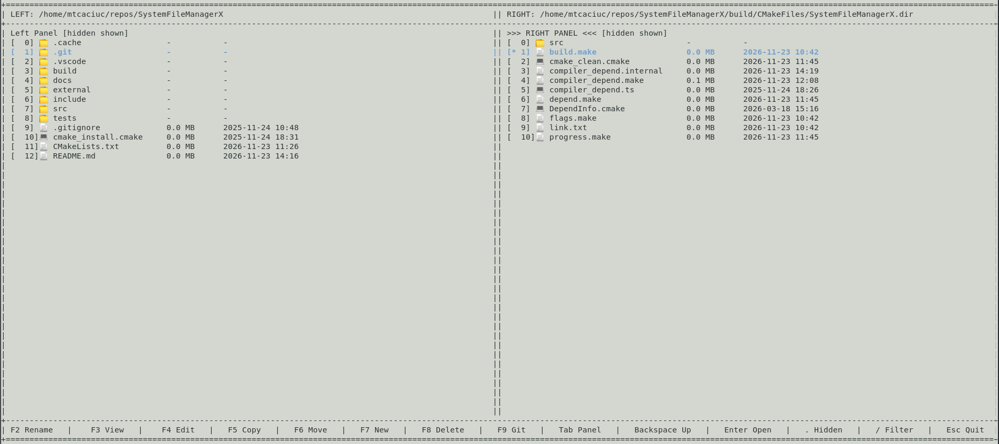
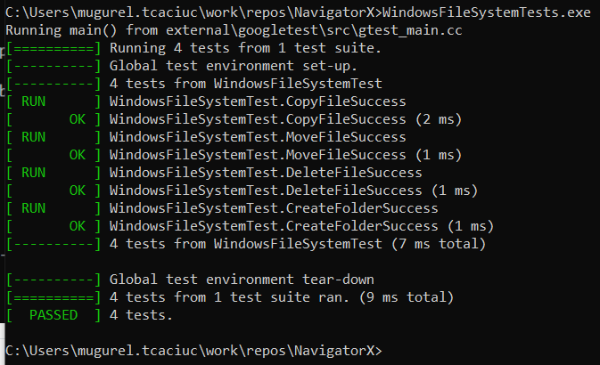

# SystemFileManagerX

**SystemFileManagerX** is a modern C++17 console-based File Manager for Windows and Linux.
It provides a fast, keyboard-driven interface for navigating directories, managing files, and exploring your system in a dual-pane layout.
---
## Features

- Dual-panel interface (left and right)
- File and folder type icons in the panel listings
- Keyboard navigation
- Home/End and Page Up/Down selection, a parent-directory entry, and per-panel
  directory history
- File operations using function keys:
  - F2 - Rename file
  - F3 - View file content
  - F4 - Edit file (opens in nano on Linux or Notepad on Windows)
  - F5 - Copy file to other panel
  - F6 - Move file to other panel
  - F7 - Create new folder
  - F8 - Delete file or folder after confirmation
  - F9 - Open the Git menu for repository status, diff, GUI, log, commit, fetch, pull, and push
  - Alt+D - Browse a running Docker container in the active panel (read-only)
  - Alt+F - Find files recursively by filename pattern (for example, `*.log`)
  - F1 - Show keyboard help
  - Alt+X - Exit
  - TAB - Switch active panel
  - BACKSPACE - Go up one folder
-  Automatic screen refresh when changing directories
-  Cross-platform (Windows, Linux – uses 'std::filesystem')

---

### Screenshot
Here's a preview of SystemFileManagerX in action:

---

### Unit Tests
Test source files are included under `tests/`. They are not currently configured as CMake test targets. Here's a screenshot of the test suite:


---

##   Technologies

- **Language:** C++17
- **Standard library:** '<filesystem>', '<thread>', '<iomanip>', '<iostream>'
- **Compiler support:** GCC, Clang, MSVC


## Build and Usage

See the [build instructions](docs/build_instructions.md) for Linux and Windows
build commands. The application starts in the working directory from which it
is launched. See the [usage guide](docs/usage.md) for navigation and keyboard
shortcuts.

## 4. Controls

SystemFileManagerX is fully keyboard-driven. Use the following keys to navigate and manage files:

- 'TAB' – Switch active panel
- 'BACKSPACE' – Go up one folder
- 'Alt+X' – Exit the application
- '.' – Toggle hidden files
- '/' – Filter the active panel by filename
- 'F2' – Rename selected file
- 'F3' – View file content
- 'F4' – Edit file in nano (Linux) or Notepad (Windows)
- 'F5' – Copy file to other panel
- 'F6' – Move file to other panel
- 'F7' – Create new folder
- 'F8' – Delete selected file
- 'F9' – Open the Git menu (push requires confirmation)


5. **Project Structure**

Project Structure
```
SystemFileManagerX/
|-- src/
|   |-- FileManager.cpp
|   |-- FileSystemFactory.cpp
|   |-- Globals.cpp
|   |-- LinuxFileSystem.cpp
|   |-- LinuxTerminal.cpp
|   |-- OsUtils.cpp
|   |-- TerminalFactory.cpp
|   |-- WindowsFileSystem.cpp
|   |-- WindowsTerminal.cpp
|   |-- main.cpp
|-- include/
|   |-- FileManager.h
|   |-- FileSystemFactory.h
|   |-- Globals.h
|   |-- IFileSystem.h
|   |-- ITerminal.h
|   |-- LinuxFileSystem.h
|   |-- LinuxTerminal.h
|   |-- OsUtils.h
|   |-- TerminalFactory.h
|   |-- WindowsFileSystem.h
|   |-- WindowsTerminal.h
|-- tests/
|   |-- LinuxFileSystemTests.cpp
|   |-- WindowsFileSystemTests.cpp
|-- docs/
|   |-- screenshots/
|       |-- systemfilemanagerx_dual_panel.png
|       |-- windows_file_system_tests.png
|-- README.md
```

Terminal dimensions and screen clearing are accessed through `ITerminal`;
`TerminalFactory` selects the Linux or Windows implementation. This keeps
platform-specific terminal operations separate from the file manager and
provides a base for moving additional console and input behavior behind the
same abstraction.


6. **Planned Improvements**

    - Color themes for directory panels
    - Command-line integration
    - Implement file preview with paging and syntax highlighting
    - Add customizable key bindings
    - Improve error handling and user feedback
    - Add search functionality within panels
    - Support for renaming folders and batch operations

7.  **License**

    This project is licensed under the MIT License.
    See the LICENSE file for details.
